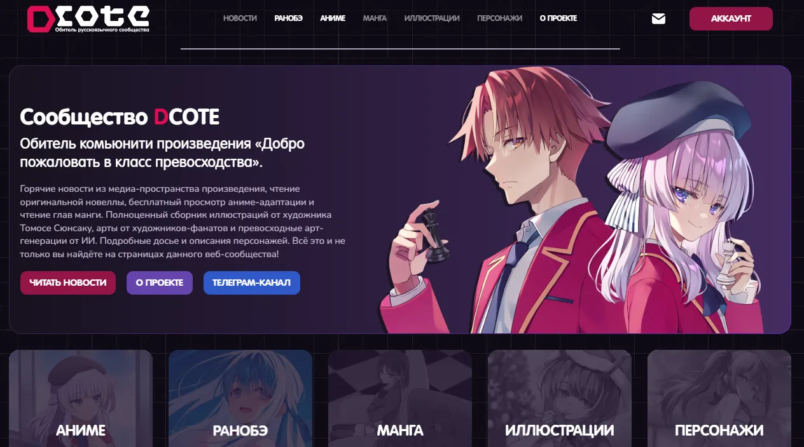
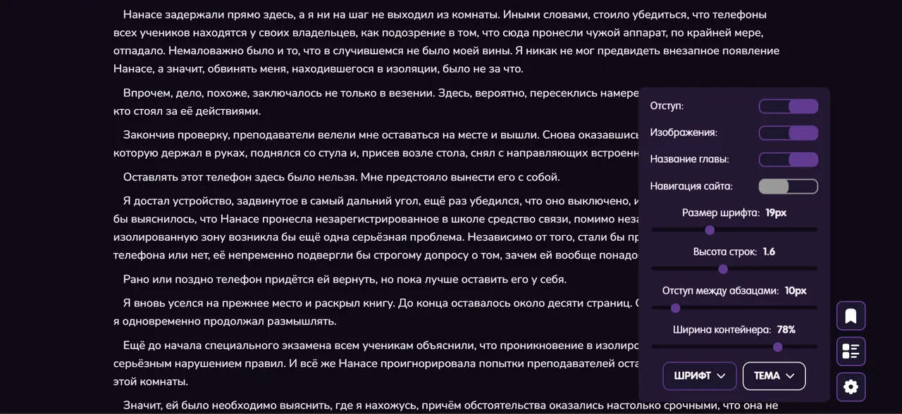
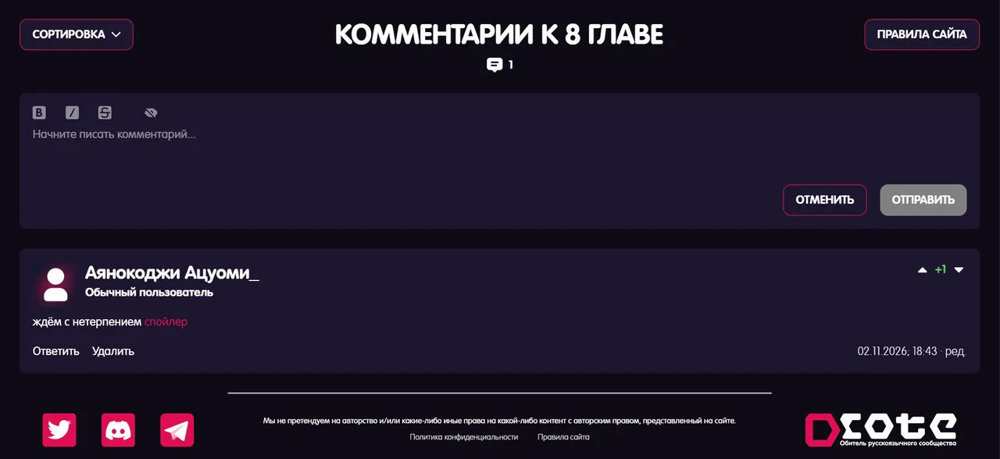
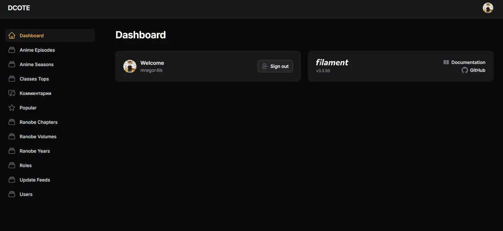
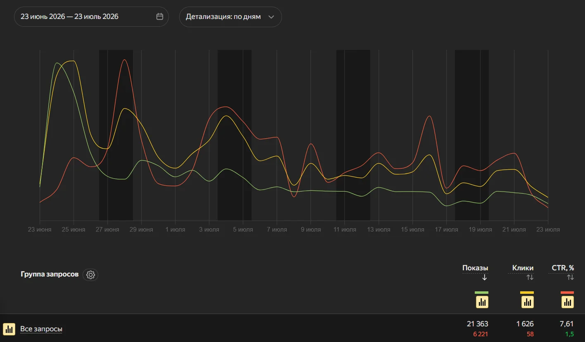

<div align="center">

<h1>
  <a href="https://dcote.net"></a>
</h1>

Медиаплатформа с каталогом ранобэ и аниме, онлайн-читалкой, видеоплеером и системой обсуждений

[О проекте](#о-проекте) · [Возможности](#возможности) · [Интерфейс](#интерфейс) · [Архитектура](#архитектура) · [Решения](#инженерные-решения) · [Метрики](#метрики) · [История](#история) · [Разработка](#разработка)

[](https://laravel.com)
[](https://php.net)
[](https://vuejs.org)
[](https://inertiajs.com)
[](https://filamentphp.com)
[](https://mysql.com)
[](https://developers.cloudflare.com/r2/)
[](https://docker.com)

</div>

## О проекте

dcote.net — сайт русскоязычного сообщества DCOTE по ранобэ и аниме «Добро пожаловать в класс превосходства» (You-Zitsu). Он начался как шутка в одном из чатов, а теперь это продакшн-платформа с библиотекой томов и глав, каталогом аниме, видеоплеером, оценками и обсуждениями.

Репозиторий содержит основное веб-приложение (Laravel, Inertia, Vue) и редакционную панель на Filament. Видеосервис и сервис метрик — отдельные проекты на поддоменах, в этот репозиторий они не входят.

<p align="center">
  
</p>

## Возможности

В читалке можно настроить шрифт, кегль, межстрочный интервал, отступы и ширину колонки, а также выбрать одну из шести цветовых тем. Выбор сохраняется между сессиями. Иллюстрации открываются в полноэкранной карусели, оригиналы можно скачать.

В каталоге аниме у сезонов и серий видны статус релиза и обратный отсчёт до выхода эпизода. Плеер умеет пропускать опенинг и показывает русские ASS-субтитры.

Комментарии работают под главами, томами, сезонами и сериями. Ответы вкладываются на любую глубину, есть реакции, редактирование и модерация. Серии и тома оцениваются по шкале от 1 до 10. В топе классов вымышленной школы Кодо Икусэй буква класса присваивается автоматически по очкам.

Контентом управляет редакционная панель Filament: одиннадцать разделов для материалов, пользователей и ролей.

## Интерфейс

<p align="center">
  
  
</p>

<p align="center">
  
  
</p>

## Архитектура

Основное приложение работает в Docker-стеке из Nginx, PHP-FPM 8.4 и MySQL 8.0. Оно отдаёт SPA на Vue, редакционную панель Filament и JSON API для оценок и комментариев.

Scheduler — отдельный контейнер с тем же образом приложения. Он каждую минуту запускает синхронизацию публикаций (см. «Автопубликация»), ночью пересобирает sitemap и делает резервную копию.

Видеосервис на `video.dcote.net` отдаёт плеер, видеопоток, постеры и ASS-субтитры. Сервис метрик на `metrics-api.dcote.net` принимает WebSocket-подключения для подсчёта онлайна и телеметрию плеера.

Медиа и аватары лежат на Docker-томе `storage-data`. Ежедневные дампы БД и медиа делает Spatie Backup: они шифруются AES-256 и уходят в отдельный бакет Cloudflare R2.

Помимо технологий из бейджей, в проекте используются Ziggy для маршрутов во фронтенде, Spatie Sitemap и Embla Carousel, а в локальном окружении ещё и Mailpit.

## Инженерные решения

### Дерево комментариев

Рекурсивные запросы по `parent_id` плохо работают на глубоких ветках и мешают пагинации. Поэтому в таблице `comments` рядом с `parent_id` хранится денормализованный `root_id`: корневые комментарии пагинируются отдельно, а ответы подгружаются одним запросом по `root_id` и собираются в дерево в памяти. Цена — лишний `UPDATE`: корневой комментарий узнаёт свой id только после вставки, поэтому `root_id` для него записывается вторым запросом. Удаление обходит ветку рекурсивно и стирает её насовсем; всё это делает модель [`Comment`](app/Models/Comment.php).

### Markdown-пайплайн

В CommonMark нет ссылок на иллюстрации по имени файла внутри тома, а часть диалогов он по ошибке превращает в нумерованные списки. [`MarkdownRanobeHelper`](app/Helpers/MarkdownRanobeHelper.php) добавляет wiki-ссылки вида `![[image.webp]]`, привязывает их к директории тома, экранирует ложные списки и нормализует заголовки и разделители сцен.

### Канонизация URL

Один и тот же материал открывался по нескольким адресам: `/anime/01` и `/anime/1`, `/ranobe/1/100.50/7.0` и `/ranobe/1/100.5/7`. Для поисковика это разные страницы. Middleware [`CanonicalNumericParameters`](app/Http/Middleware/CanonicalNumericParameters.php) приводит числовые сегменты к каноничному виду и отвечает редиректом 301. Страницы отдают Open Graph, канонический URL и JSON-LD, а sitemap пересобирается ночью, и `lastmod` в нём берётся из дат обновления моделей.

### Автопубликация

Обновлять статусы серий и сезонов вручную легко забыть. Команда [`SyncPublicationState`](app/Console/Commands/SyncPublicationState.php) каждую минуту выпускает серии при наступлении `release_date` и закрывает сезоны и тома, когда вышли все эпизоды и главы. Она идемпотентна, поэтому повторный запуск безопасен.

### Обрезание текста

`-webkit-line-clamp` не умеет ставить кнопку «Развернуть» в конец последней строки. Поэтому [`ClampedText.vue`](resources/js/Components/ClampedText.vue) подбирает длину текста бинарным поиском по словам и проверяет, влезает ли он в блок, по `scrollHeight`. Результат пересчитывается через `ResizeObserver` при изменении ширины и после `document.fonts.ready`, когда загрузятся шрифты.

### Псевдоним пользователя для метрик

Сервису метрик не нужны реальные `user_id`. Бэкенд формирует HMAC-SHA256 псевдоним и передаёт только его. Контракт закреплён тестом [`MetricsIntegrationContractTest`](tests/Unit/MetricsIntegrationContractTest.php).

## Метрики

Данные за 23 июня – 23 июля 2026 из Google Search Console, Яндекс.Вебмастера и собственного сервиса метрик.

| Метрика                  | Значение                 |
| ------------------------ | ------------------------ |
| Переходы из поиска       | ~4 600 за месяц          |
| Пиковый онлайн           | 300 человек одновременно |
| Показы в поиске          | ~116 000 за месяц        |
| Средняя позиция в Google | 6,7                      |

<details>
<summary>Скриншоты метрик</summary>

<p align="center">
  
</p>

<p align="center">
  
</p>

</details>

## История

Первые макеты нашей концепт-дизайнера были сделаны в Alight Motion, программе для видеомонтажа. Верстать я тогда не умел и два часа делал шапку: линия сверху на всю ширину и текст внутри. Сначала был чистый HTML, потом немного PHP, затем Laravel, а после него Vue с Inertia. Верстал я сначала по готовым картинкам, затем по макетам из конструктора вроде Wix и только потом по Figma.

## Разработка

### Локальный запуск

Для сборки фронтенда нужен Node.js 20.19+ или 22.12+.

```bash
cp .env.example .env
docker compose -f docker-compose.dev.yml run --rm --no-deps app composer install
docker compose -f docker-compose.dev.yml up -d --build
docker compose -f docker-compose.dev.yml exec app php artisan key:generate
docker compose -f docker-compose.dev.yml exec app php artisan migrate
docker compose -f docker-compose.dev.yml exec app php artisan storage:link --force
npm ci && npm run dev
```

Приложение доступно на `http://localhost:8080`. В локальном окружении тестовые аккаунты `dev01`–`dev04` создаются командой `docker compose -f docker-compose.dev.yml exec app php artisan db:seed`; пароль у всех — `12345678`. Исходящие письма перехватываются в Mailpit на `http://localhost:8025`.

### Тесты и проверки

```bash
docker compose -f docker-compose.dev.yml exec app php artisan test
docker compose -f docker-compose.dev.yml exec app ./vendor/bin/pint --test
npm run lint
npm run format:check
npm run build
```

GitHub Actions запускает тесты и Pint на каждый pull request и на пуш в `main` или `production`. Деплой на продакшн-сервер по SSH выполняется только после успешного прогона тестов.

---

<div align="center">

[backspace-08](https://github.com/backspace-08)

</div>
