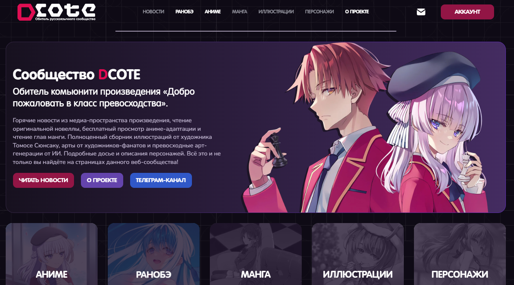
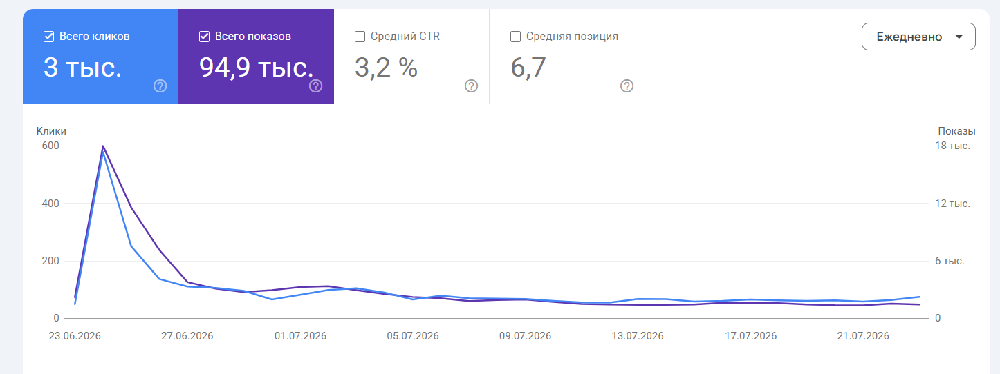
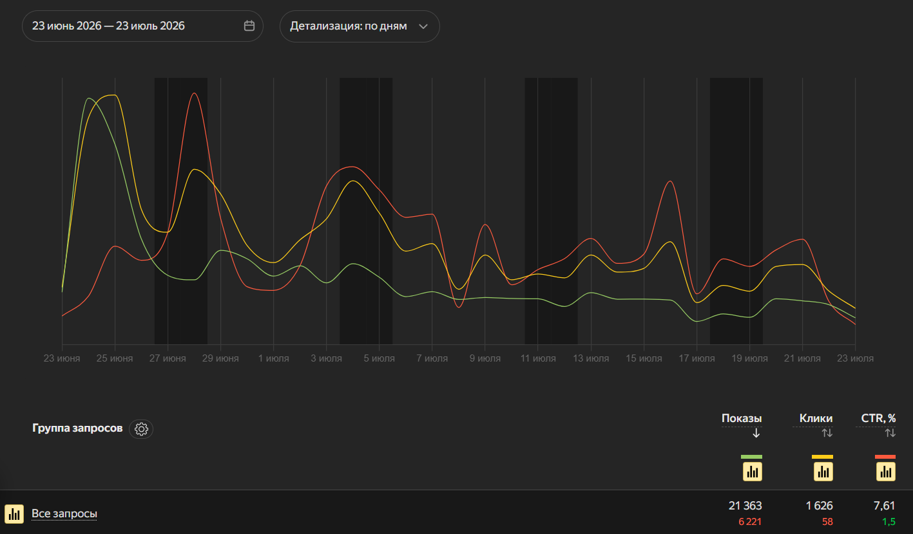

<div align="center">

<br>

<a href="https://dcote.net">
  
</a>

**Медиаплатформа с каталогом ранобэ и аниме, онлайн-читалкой, видеоплеером и системой обсуждений**

[О проекте](#о-проекте) · [Аудитория](#аудитория-и-метрики) · [Архитектура](#архитектура) · [Инженерные решения](#инженерные-решения) · [Стек](#стек) · [Разработка](#разработка)

[](https://laravel.com)
[](https://php.net)
[](https://vuejs.org)
[](https://inertiajs.com)
[](https://filamentphp.com)
[](https://mysql.com)
[](https://developers.cloudflare.com/r2/)
[](https://docker.com)

<br>



</div>

---

## О проекте

**dcote.net** — продакшн-платформа русскоязычного сообщества по ранобэ и аниме «Добро пожаловать в класс превосходства», известным также как You-Zitsu. Платформа объединяет библиотеку переводов ранобэ с разбивкой по годам, томам и главам, каталог сезонов и серий аниме, галереи иллюстраций, оценки и древовидные обсуждения.

Репозиторий содержит основное веб-приложение на Laravel 10, Inertia 2 и Vue 3, а также редакционную панель на Filament 3. Видеосервис с плеером и субтитрами и сервис метрик работают на отдельных поддоменах.

## Аудитория и метрики

Данные за период с 23 июня по 23 июля 2026 года.

| Метрика         | Значение                                                    | Источник                                |
| --------------- | ----------------------------------------------------------- | --------------------------------------- |
| Показы в поиске | ~116 000 за месяц: 94,9 тыс. в Google и 21,3 тыс. в Яндексе | Google Search Console, Яндекс.Вебмастер |
| Переходы        | ~4 600 за месяц, CTR 3,2 % в Google и 7,6 % в Яндексе       | Google Search Console, Яндекс.Вебмастер |
| Средняя позиция | 6,7 в Google                                                | Google Search Console                   |
| Пиковый онлайн  | 300 человек одновременно                                    | Сервис метрик DCOTE                     |

<div align="center">

**Google Search Console: показы и клики**



<br><br>

**Яндекс.Вебмастер: показы, клики и CTR по запросам**



</div>

## Функциональность

- **Библиотека ранобэ.** Навигация по годам, томам и главам, читалка с настройками шрифта, кегля, интервалов и ширины колонки, шесть цветовых тем с сохранением выбора.
- **Каталог аниме.** Сезоны и серии, статус релиза, обратный отсчёт до эпизода, встроенный плеер с пропуском опенинга и русскими ASS-субтитрами.
- **Обсуждения.** Полиморфные комментарии к главам, томам, сезонам и сериям, дерево ответов произвольной глубины, реакции, редактирование и модерация.
- **Рейтинги и топы.** Оценки от 1 до 10 для серий и томов с мгновенным пересчётом среднего, топ классов Кодо Икусэй с автоматическим присвоением букв по очкам.
- **Редакционная панель.** Одиннадцать ресурсов Filament 3 для управления контентом, пользователями и ролями.

## Архитектура

Платформа состоит из основного приложения и двух сервисов на отдельных поддоменах.

| Контур                  | Роль                                                                                                                                                                                     |
| ----------------------- | ---------------------------------------------------------------------------------------------------------------------------------------------------------------------------------------- |
| **Основное приложение** | Docker-стек Nginx, PHP-FPM 8.4 и MySQL 8.0. Отдаёт SPA на Vue 3, редакционную панель Filament и JSON API для оценок и комментариев.                                                      |
| **Scheduler**           | Отдельный контейнер с тем же образом приложения. Каждую минуту синхронизирует выход серий и статусы сезонов и томов, ночью пересобирает sitemap и запускает резервное копирование.       |
| **Видеосервис**         | `video.dcote.net` — плеер, видеопоток, постеры и ASS-субтитры по сезонам и сериям.                                                                                                       |
| **Сервис метрик**       | `metrics-api.dcote.net` — WebSocket-подключения для подсчёта онлайна и телеметрия видеоплеера.                                                                                           |
| **Хранение**            | Медиа и аватары лежат на Docker-томе `storage-data`. Ежедневные дампы БД и медиа шифруются AES-256 и выгружаются в отдельный бакет Cloudflare R2 с ротацией и алертами через Brevo SMTP. |

## Инженерные решения

- **Дерево комментариев без рекурсивных запросов.** В таблице `comments` рядом с `parent_id` хранится денормализованный `root_id`. Корневые комментарии пагинируются отдельно, ответы подгружаются одним запросом `WHERE root_id IN (...)` и собираются в дерево в памяти. Удаление узла обходит поддерево в транзакции.
- **Собственный Markdown-пайплайн для ранобэ.** `MarkdownRanobeHelper` расширяет CommonMark: поддерживает wiki-ссылки на иллюстрации вида `![[image.webp]]` с привязкой к директории тома, экранирует ложные нумерованные списки в диалогах, нормализует заголовки и разделители сцен и проставляет ленивую загрузку изображений.
- **SEO и защита от дублей.** Middleware `CanonicalNumericParameters` перехватывает неканоничные числовые сегменты вроде `/anime/01` или `/ranobe/1/100.50/7.0` и отвечает редиректом 301. На страницах выводятся Open Graph, Twitter Cards, канонический URL и JSON-LD типов `Organization`, `WebSite`, `Article` и `VideoObject`. Sitemap генерируется по расписанию с честным `lastmod`.
- **Автоматическая публикация по расписанию.** Идемпотентная команда `publication:sync` каждую минуту выпускает серии при наступлении `release_date` и закрывает сезоны и тома, когда все эпизоды и главы вышли.
- **Контракт с сервисом метрик.** Для авторизованных пользователей бэкенд формирует HMAC-SHA256 псевдоним от `user_id`, поэтому реальные идентификаторы не попадают во внешний трекер. Контракт покрыт unit-тестом `MetricsIntegrationContractTest`.
- **Точное обрезание текста в `ClampedText.vue`.** Вместо `-webkit-line-clamp` используется бинарный поиск по словам с проверкой `scrollHeight <= clientHeight`, `ResizeObserver` и ожиданием `document.fonts.ready`. Многоточие и кнопка «Развернуть» всегда оказываются в конце последней строки без скачков вёрстки.
- **Безопасность и отказоустойчивость.** SPA-аутентификация на Sanctum хранит сессию в cookie и не кладёт токены в `localStorage`. Формы защищены Cloudflare Turnstile, `intended`-редиректы проверяются на open-redirect. Бэкапы БД и медиа шифруются AES-256 и уходят в отдельный бакет Cloudflare R2, уведомления приходят только при сбоях.

## Стек

| Категория             | Технологии                                                                                          |
| --------------------- | --------------------------------------------------------------------------------------------------- |
| **Backend**           | PHP 8.4, Laravel 10, Laravel Sanctum, Filament 3.3, Ziggy, Spatie Sitemap, Spatie Backup            |
| **Frontend**          | Vue 3.5 со `<script setup>`, Inertia.js 2.0, Vite 8, Embla Carousel, нативный CSS с дизайн-токенами |
| **Данные и хранение** | MySQL 8.0, Docker-том `storage-data`, Cloudflare R2 для архивов резервных копий                     |
| **Инфраструктура**    | Docker Compose для dev и prod, Nginx 1.27, PHP-FPM, Brevo SMTP, Mailpit в dev                       |
| **Качество**          | PHPUnit 10, Laravel Pint, ESLint 10, Prettier                                                       |

## Разработка

```bash
# Тесты и кодстайл
docker compose -f docker-compose.dev.yml exec app php artisan test
docker compose -f docker-compose.dev.yml exec app ./vendor/bin/pint --test

# Линтер, форматтер и сборка фронтенда
npm run lint
npm run format:check
npm run build
```

GitHub Actions запускает тесты и Pint на каждый pull request и на пуш в `main` или `production`. Деплой на продакшн-сервер по SSH выполняется только после успешного прогона тестов.

<details>
<summary><b>Локальное окружение</b></summary>

```bash
cp .env.example .env
docker compose -f docker-compose.dev.yml up -d --build
docker compose -f docker-compose.dev.yml exec app composer install
docker compose -f docker-compose.dev.yml exec app php artisan key:generate
docker compose -f docker-compose.dev.yml exec app php artisan migrate
docker compose -f docker-compose.dev.yml exec app php artisan storage:link
npm ci && npm run dev
```

Приложение доступно на `http://localhost:8080`. Тестовые аккаунты `dev01`–`dev04` создаются командой `php artisan db:seed --class=TestAccountsSeeder`. Исходящие письма перехватываются в Mailpit на `http://localhost:8025`.

</details>

---

<div align="center">

**[dcote.net](https://dcote.net)**

</div>
